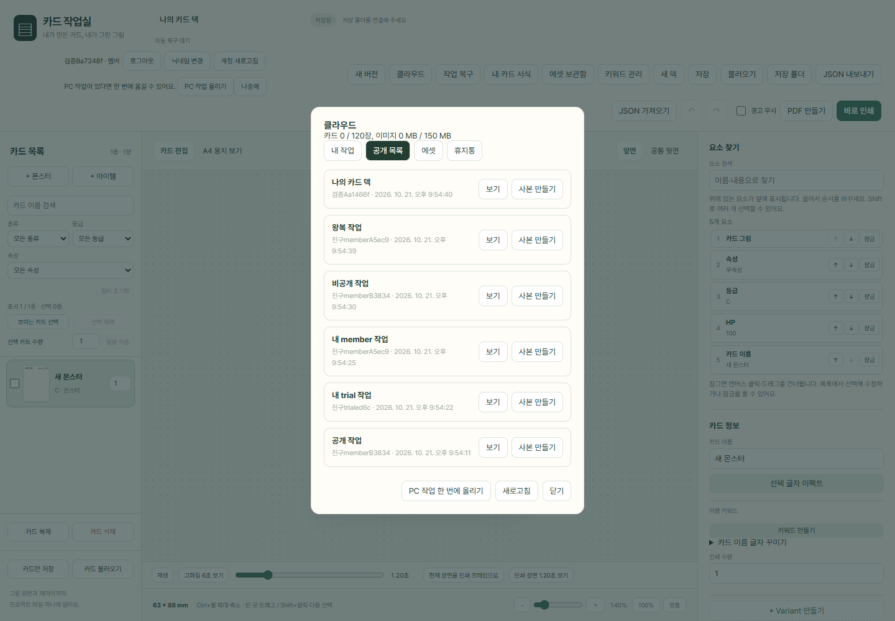
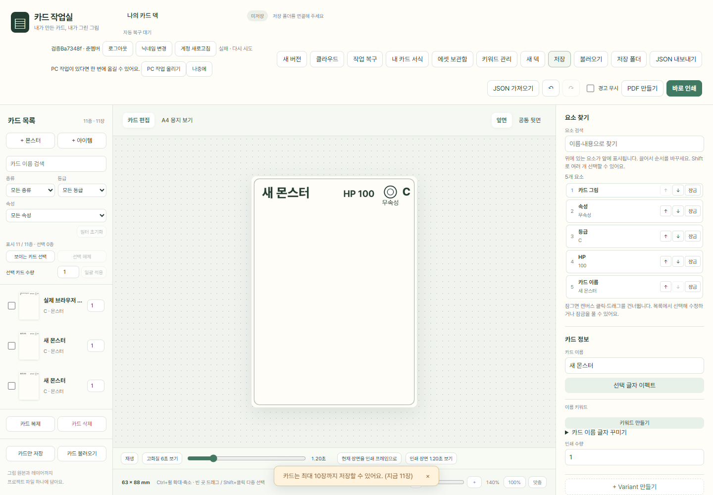
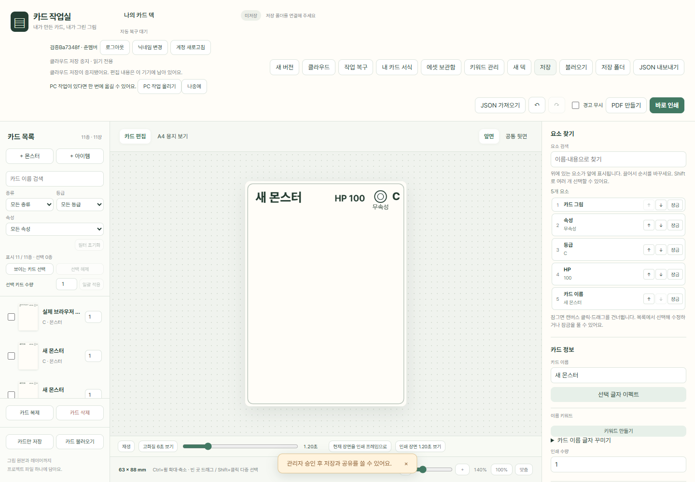
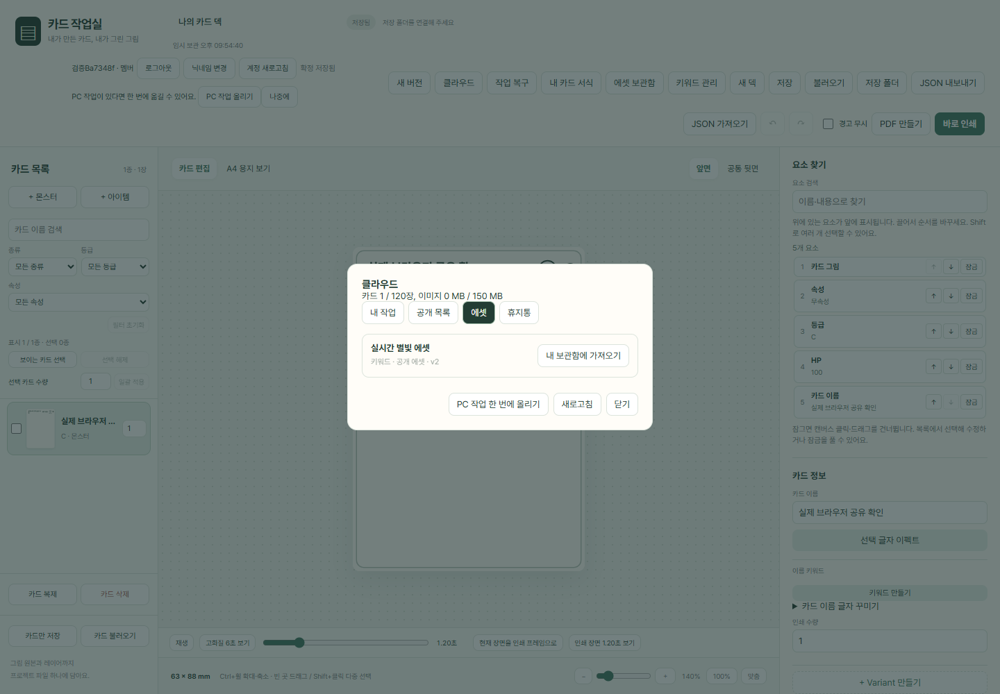
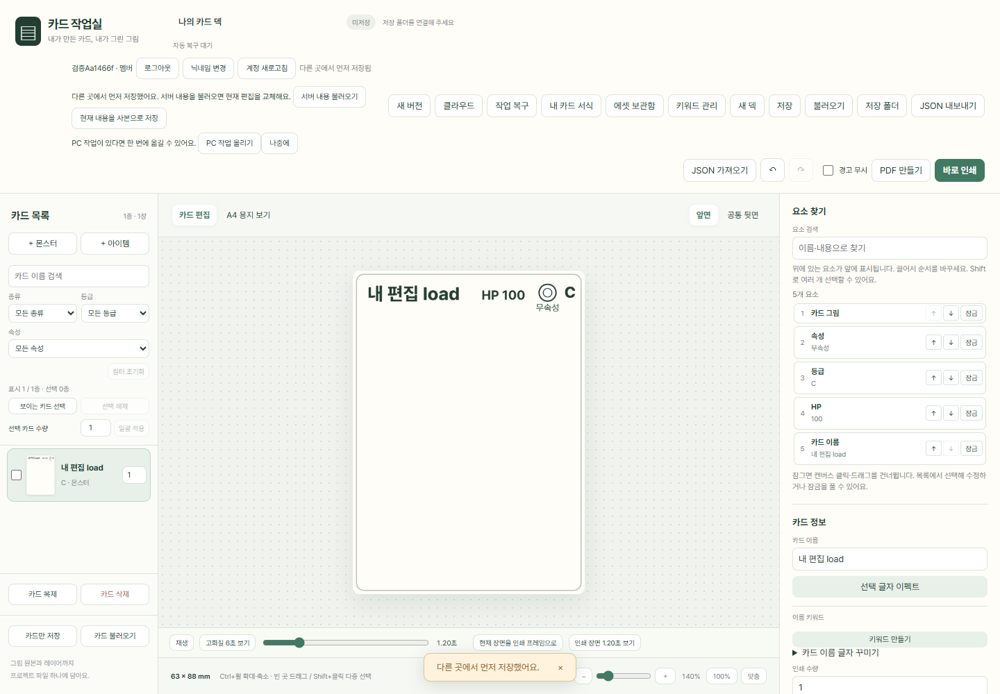

# 클라우드 검증 기록

대상 브랜치: `feat/cloud-sharing`. 아래 날짜별 기록은 각 검증 시점의 결과다. 현재 1.6.0 배포를 준비하고 있으며, 운영 DB·서버 함수·Google 로그인 설정을 연결했다. Pages·Release 게시와 첫 운영 백업의 결과는 확인 후 기록한다.

## 2026-10-21 로컬 검증

- Supabase CLI 2.121.0, PostgreSQL 17.11, Edge runtime 1.77.4, Node 24.19.0, 실제 Microsoft Edge 사용.
- 부록 A의 SQL 세 파일은 원문과 대조한다. 부록 B의 anon/pending/revoked/trial/member 권한은 실제 REST·Storage·함수 호출로 검사한다.
- 두 개의 독립 Edge 프로필에서 실제 로컬 이메일 세션으로 공개 → 실시간 목록 반영 → 사본을 확인했다. 에셋 탭을 열어 둔 채 공개·수정·비공개·삭제가 반영되고, 저장 충돌의 서버 내용 불러오기·사본 저장도 확인했다. 준멤버는 10장까지 저장되고 11장째는 거부됐다. 승인 해제 후 다음 저장은 즉시 차단됐다. 페이지 스크립트 오류는 0개였다.
- 백업 → 실제 로컬 DB reset → 세 마이그레이션 재적용 → 데이터·그림 복원이 통과했다. 수량·그림 해시·복원 후 계정 로그인 결과는 [cloud-admin.md](cloud-admin.md)에 있다.
- 전체 단위 검사 492개, 브라우저 검사 510개, 실제 로컬 통합 검사 20개가 통과했다. 실패는 0개다. 모델 파일이 필요한 선택적 실제 U2NetP 추론 검사 1개만 건너뛰었다.

## 리뷰 수정

전체 브랜치에 대한 별도 리뷰에서 중요한 문제 8개를 확인했다. 각 문제를 먼저 실패하는 테스트로 재현한 뒤 수정했고 `2dc9ed6`에 커밋했다. 보류한 경미한 지적은 없다.

계획과 달리 판단한 35개 사항과 각각의 영향은 [구현 판단 기록](cloud-implementation-decisions.md)에 순서대로 보관했다. Task 15의 두 프로필 시나리오는 실제 Edge 화면 조작을 자동화하고 스크린샷을 살피는 방식으로 검증했다. 기계 판독 결과는 [result.json](evidence/cloud/result.json)에 있다.

| 문제 | 수정 결과와 검증 |
| --- | --- |
| 업로드 중 계정 변경 | 작업을 시작한 계정으로만 요청하며, 이전 계정의 덱은 로컬 복구 내용을 유지한 채 저장을 중지한다. 그림 보관함·공유·PC 가져오기에도 적용했다. |
| 미연결 이미지로 한도 우회 | 아직 작업에 연결하지 않은 업로드도 한도에 예약한다. 준멤버가 8 MiB 이미지를 두 번 올릴 때 두 번째를 실제 HTTP에서 거부했다. |
| 이미지 정리 도중 일부 삭제 실패 | 삭제 중인 자료를 먼저 사용 불가로 확정하고 재시도 기록을 남긴다. 실제 DB·Storage에서 중간 실패 → 재업로드 → 기록 해제 → 정상 저장을 확인했다. |
| 충돌 선택 버튼 없음 | 서버 내용 불러오기·현재 편집을 사본으로 저장을 화면에서 선택한다. 두 선택 모두 실제 서버에서 확인했다. |
| 에셋 실시간 변경 누락 | 공개·수정·비공개·삭제를 현재 에셋 목록에도 즉시 반영한다. |
| 목록 조회와 실시간 이벤트 순서 충돌 | 조회 중 도착한 이벤트를 순서대로 다시 적용해 삭제한 항목이 재등장하거나 새 항목이 사라지지 않는다. |
| REST 1,000행 제한 | 일정한 순서로 나누어 읽는다. 실제 2,004행 중 내 에셋 1,002개와 공개 에셋 1,002개를 모두 확인했다. |
| 내 에셋 재사용 불가 | 보관한 키워드·서식·이펙트를 현재 덱에 적용한다. 그림 읽기가 실패해도 이미 만든 사본을 다시 적용할 수 있다. |

미연결 이미지 예약량은 부록 A의 원문을 유지한 `my_usage()` 표시량에는 포함되지 않는다. 따라서 이미지를 올린 직후에는 실제 저장 한도가 표시 사용량보다 먼저 차단될 수 있으며, 작업에 연결하거나 정리하면 해소된다. 정리는 기존 서버 전용 감사 기록에 삭제 재시도를 남기며, DB 연결 하나를 유지하는 동안 쓰기 요청을 잠시 대기시킨다.

## 다시 실행하기

`.env.cloud-test`에 로컬 테스트 값 네 개를 준비한다. 이 파일은 커밋하지 않는다. 검사는 명시적인 localhost/127.0.0.1 주소만 허용하고 테스트 전용 계정과 자료를 만들고 지운다.

```text
npm run test:unit
npm run build
npm run test:browser
npm run test:cloud
npm run test:cloud:ui
```

로컬 함수 서버의 비공개 `.env.local`에는 `ALLOWED_ORIGINS=http://localhost:4173`, `PUBLIC_SUPABASE_URL=http://127.0.0.1:54321`을 설정한다. UI 검증은 4173 포트를 쓰며 별도 출력 경로에 빌드하므로 정식 `dist/`를 바꾸지 않는다.

백업 복원은 일반 테스트에 포함하지 않는다. `node --env-file=.env.cloud-test scripts/verify-local-backup.mjs --reset-local`을 명시적으로 실행할 때만 로컬 DB를 초기화한다. Docker/Supabase 실행 파일이 PATH에 없으면 `DOCKER_BIN`, `SUPABASE_CLI`를 지정한다.

최종 로그는 `artifacts/qa/cloud-unit-final.log`, `cloud-build.log`, `cloud-browser-final.log`, `cloud-integration.log`, `cloud-ui.log`와 `cloud-browser-result.json`에 보관한다. SQL·브라우저 프로필·인증 데이터는 이 디렉터리에서만 관리하고 커밋하지 않는다.

## 화면 증거







## 최종 검사와 리뷰

검증한 소스 커밋은 `2dc9ed65dfa8aaffcbe543987b86fb97c3b403a4`다. 그 이후 변경은 이 검증 문서와 증거 파일뿐이다. 집계는 [verification.json](evidence/cloud/verification.json)에 보관한다.

| 검사 | 통과 | 실패 | 건너뜀 |
| --- | ---: | ---: | ---: |
| 전체 단위 검사 | 492 | 0 | 0 |
| 전체 브라우저 검사 | 510 | 0 | 1 |
| 실제 로컬 Supabase 통합 검사 | 20 | 0 | 0 |
| 합계 | 1,022 | 0 | 1 |

두 프로필 실제 UI 시나리오도 통과했고 페이지 오류는 0개였다. HTML 빌드는 5.29 MiB로 성공했으며 번들 라이선스 24개를 포함한다. `dist/card-print-studio.html`의 SHA-256은 `1947E239C572B98D64F877DC85083974E3825297F26E2505A8EDCB42E8838E4E`다.

선택적 검사 1개는 `CARD_BG_MODEL_DIR`에 고정된 `ort.min.js`, `ort-wasm-simd.wasm`, `u2netp.onnx` 파일이 없어 실행하지 않았다. 다른 배경 제거 검사와 오프라인 브라우저 검사는 통과했다. 실제 모델 추론까지 검증했다고 주장하지 않는다.

Task 1–14와 Task 15 Steps 1–2의 로컬 구현·검증을 마쳤다. 중요한 리뷰 지적 8개는 실패 재현 → 수정 → 통과 후 전체 검사로 확인했다. 보류한 경미한 지적은 없다. 부록 A 마이그레이션은 `b02c766` 이후 변경하지 않았다.

Task 15 Step 3은 2026-10-22 사용자의 “깃헙에 올리고 서버까지 연동하자” 요청으로 운영 반영 승인을 받았다. `feat/cloud-sharing` 브랜치를 GitHub에 게시하고 Pages를 GitHub Actions 방식으로 설정했다. 요청 당시 운영 Supabase 로그인·프로젝트 연결과 공개 URL/키, Google OAuth, 백업용 비밀 설정이 준비되지 않아 게시를 보류했다. 이후 받은 공개 설정과 운영 상태는 아래에 기록한다.

운영 준비 중 `origin/main`의 v1.5.3 제목 키워드 수정을 이 작업 브랜치에 통합했다. 별도 작업 폴더는 수정하지 않았다. 충돌은 카드 한 장 파일의 제목·본문 자동 키워드와 전용 이펙트 의존 이미지 보존을 유지하고, HTML과 서버 검증 번들을 다시 생성하는 방식으로 해결했다. 통합 후 관련 검사 113개와 실제 브라우저 검사 7개(다크모드, 키워드 이펙트, 오프라인 저장·인쇄)가 통과했다. 비밀 키 누출 검사와 부록 A SQL 원문 검사도 통과했다. 로그는 `artifacts/qa/publish-merged-unit.log`, `publish-merged-browser.log`에 보관한다.

## 운영 연결 준비 — 2026-10-22

사용자가 GitHub 업로드와 운영 서버 연동을 요청하여 Task 15 Step 3의 운영 반영을 승인했다. 이후 제공한 프로젝트 ref `ytushlpqhdqyimwyempg`와 publishable 공개 키만 `cloud.json`에 반영했다. 비밀 키·DB 비밀번호는 받거나 커밋하지 않았다.

공개 키로 처음 조회했을 때 Auth 설정은 HTTP 200, Google 공급자는 꺼짐, Email 공급자는 켜짐이었다. `profiles`와 `export-manifest`는 아직 없었다. 이후 사용자가 공식 CLI의 일회용 인증을 완료했고, 프로젝트 이름 `PP Monster`·지역 `ap-northeast-2`·상태 `ACTIVE_HEALTHY`를 확인한 뒤 연결했다.

공개 설정 반영 후 빌드 성공, CSP·비밀 키 유출 방지·SQL 원문·클라이언트·클라우드 형식 검사 24/24 통과. 이 결과는 운영 저장·Google 로그인·백업 성공을 의미하지 않는다. 서버 배포 및 인증 설정 확인 전에는 버전을 1.6.0으로 올리거나 Pages에 게시하지 않는다.

## 운영 서버 반영 — 2026-10-22

`db push --dry-run`에서 계획의 마이그레이션 세 개만 확인한 뒤 그대로 적용했다. 운영 이력의 `20261021000001`·`20261021000002`·`20261021000003`이 로컬과 일치한다. 부록 A SQL은 수정하지 않았다. 운영의 앱 표 10개 모두 RLS가 켜져 있고, 클라이언트의 작업 INSERT 및 감사·그림 메타데이터 읽기 권한 회수가 적용됐다. `blobs` 버킷은 공개 다운로드, 최대 20 MiB, PNG/JPEG/WebP 제한이며 Realtime 공개 대상은 `public_feed`뿐이다.

`ALLOWED_ORIGINS=https://lolipop000000.github.io`를 설정하고 `api`·`export-manifest`·`maintenance`를 배포했다. 세 함수 모두 ACTIVE/버전 1이며, 계획대로 게이트웨이 JWT 검사 대신 각 핸들러의 권한 검사를 사용한다. 정리 함수는 관리 키 없이 거부되는지만 확인했고 정리 작업 자체는 실행하지 않았다.

| 실제 운영 HTTP 검사 | 결과 |
|---|---|
| 로그인 없는 공개 manifest GET | 200, `card-print-studio-manifest` |
| 로그인 없는 저장 API POST | 401, `unauthenticated` |
| Pages 출처의 API OPTIONS | 204, 지정한 출처 허용 |
| 허용하지 않은 출처의 API OPTIONS | 403, 출처 허용 헤더 없음 |
| 로그인 없는 정리 함수 POST | 401, `unauthorized` |

상세 공개 응답 기록은 커밋에서 제외한 `artifacts/qa/production-cloud-probe.json`에 있다. 별도 임시 설정으로 Auth Site URL을 `https://lolipop000000.github.io/card-print-studio/`, 추가 redirect를 `https://lolipop000000.github.io/card-print-studio/**`로 설정했다. 적용 전 두 update만 검토했고, 선언하지 않은 기존 Auth·MFA·Storage 등 8개 설정은 보존했다. 로컬 개발용 `supabase/config.toml`은 바꾸지 않았다.

비공개 백업 저장소 `lolipop000000/card-print-studio-backup`을 만들고 비공개 여부를 확인했다. Actions에는 공개 값인 `SUPABASE_URL`만 등록했다. 관리 키·DB 접속 비밀번호·백업 전용 최소 권한 토큰은 아직 등록되지 않아 자동 백업과 첫 워크플로 검증은 미완료다. Google 로그인 연결은 사용자가 Google Cloud 프로젝트를 만든 뒤 기본 앱 설정을 진행 중이며, 실제 로그인·저장과 최종 Pages/Release 게시는 아직 완료되지 않았다.

## Google 로그인 연결 확인 — 2026-10-22

사용자가 Google 로그인 앱 이름을 `PP Login`으로 정하고 OAuth 클라이언트 비밀을 Supabase에 직접 입력했다. 운영 공개 설정 조회에서 Google `true`, Email `false`, 신규 가입 허용을 확인했다. 인증 시작 요청은 Google의 `accounts.google.com`으로 HTTP 302 이동했고, 클라이언트 ID 형식과 Supabase callback 주소가 일치했다. 사용자는 Google 테스트 사용자 등록도 완료했다. 이 확인에는 실제 계정 로그인과 카드 저장은 포함되지 않는다.

배포 파일을 1.6.0으로 올리고 package·lock·release·update의 버전 일치 및 두 HTML의 바이트 일치를 확인했다. 새로운 빌드에서 전체 단위 검사 510/510과 로컬 Supabase 통합 검사 21/21이 통과했다. 전체 브라우저 검사는 524개 통과·실패 0개이며, 고정 모델 파일이 필요한 선택적 U2NetP 실제 추론 1개를 생략했다. 로그는 `artifacts/qa/cloud-release-unit.log`, `cloud-release-browser.log`, `cloud-release-integration.log`, 공개 인증 확인은 `production-auth-probe.json`에 보관한다. 백업 관리 키·DB 접속 주소·백업 저장소 전용 토큰은 사용자가 GitHub Actions에 직접 등록했으며 값은 읽지 않고 네 설정 이름만 확인했다.

## PP Monster 표시 이름 — 2026-10-22

사용자 요청으로 화면·브라우저 탭·업데이트 창·로딩과 오류 안내·PDF 제작자 이름을 PP Monster로 바꿨다. 기존 JSON 형식·브라우저 저장 설정·다운로드 파일명과 저장소 주소를 유지한다. 제목이 예전 이름이라 실패하는 브라우저 검사를 확인한 뒤 변경했고, 최종 빌드의 이름·기존 JSON 저장과 재열기·PDF 표시 검사 1/1, 영향 범위 브라우저 검사 29/29, 전체 단위 검사 510/510이 통과했다. 원래 전체 브라우저 회귀는 이름 변경 전에 끝냈으며, 이름 변경 후 전체 회귀를 다시 수행한 것으로 표현하지 않는다. 최종 HTML과 해시는 [verification.md](verification.md)에 있다.
